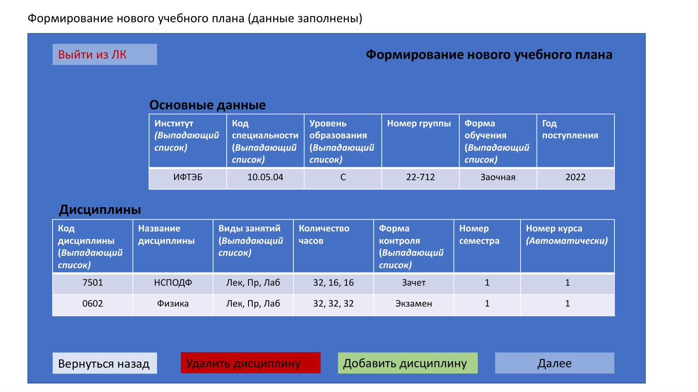
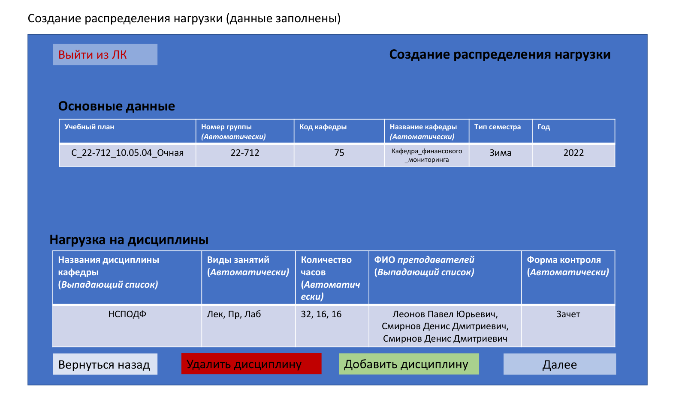
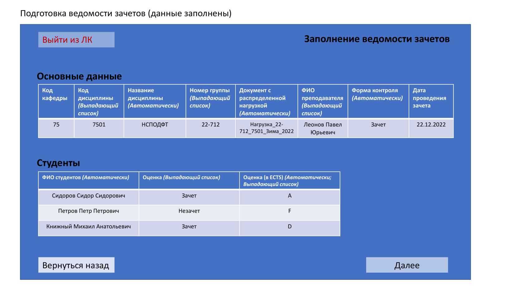

# Информационная система управления учебным процессом

Учебный проект по системному анализу. Спроектировал работу системы для сотрудников деканата, кафедр и преподавателей: от создания учебного плана до распределения нагрузки и заполнения ведомостей.

**Автор:** Александр Куликов.

**Основные материалы:** [Техническое задание](requirements/technical-specification.pdf) · [Макеты интерфейсов](mockups/interfaces.pdf) · [Программа и методика испытаний](testing/test-plan.pdf).

## Что я сделал

- Разработал техническое задание: функции трех ролей, входные данные, результаты операций, требования к надежности и совместимости.
- Описал структуру данных: 7 таблиц с полями, типами данных и назначением каждого поля.
- Подготовил 30+ макетов экранов и их состояний: формы ввода, списки документов, предварительный просмотр и переходы между экранами.
- Разработал программу и методику испытаний: 50+ проверок с действиями пользователя и ожидаемыми результатами, включая ошибки авторизации.

## Задача системы

Связать учебные планы, нагрузку преподавателей и ведомости в последовательный процесс. Участники используют данные предыдущих этапов: нагрузка распределяется на основе утвержденного плана, а ведомости заполняются с учетом выбранной дисциплины, группы и преподавателя.

| Роль | Основные возможности |
| --- | --- |
| Сотрудник деканата | Создание, изменение и утверждение учебных планов |
| Сотрудник кафедры | Распределение учебной нагрузки между преподавателями |
| Преподаватель | Заполнение ведомостей зачетов, экзаменов, пересдач и комиссий |

## Примеры проработанных правил

- **Утверждение учебного плана.** После утверждения план становится недоступен для редактирования и появляется в списке утвержденных планов.
- **Распределение нагрузки.** Дисциплины, виды занятий и часы подставляются из утвержденного плана; преподаватели выбираются из соответствующего списка.
- **Пересдачи.** В ведомость пересдачи зачета попадают студенты с неудовлетворительным результатом предыдущей попытки; их список формируется автоматически.
- **Подготовка документов.** Для учебных планов, распределений нагрузки и ведомостей предусмотрены предварительный просмотр и сохранение в формате DOCX.

## Материалы проекта

| Материал | Что посмотреть |
| --- | --- |
| [Техническое задание](requirements/technical-specification.pdf) | Функции и данные по ролям — раздел 4.1; структура данных — раздел 9.1 |
| [Макеты интерфейсов](mockups/interfaces.pdf) | Экранные формы и их состояния для всех трех ролей |
| [Программа и методика испытаний](testing/test-plan.pdf) | Тестовые данные, последовательность проверок и ожидаемые результаты |

В разделе 9.1 технического задания описаны таблицы: «Специальности», «Дисциплины», «Кафедры», «Преподаватели», «Студенты», «Распределения нагрузки», «Институты». В требованиях предусмотрено использование PostgreSQL.

## Примеры интерфейсов

### Формирование учебного плана

### Распределение нагрузки преподавателей

### Заполнение ведомости зачета

Полный набор экранов — в [документе с макетами](mockups/interfaces.pdf).

## Формат проекта

Репозиторий содержит аналитические материалы учебного проекта: требования, описание данных, макеты и программу испытаний. Организации, реквизиты и учетные записи в документах относятся к учебному сценарию.
